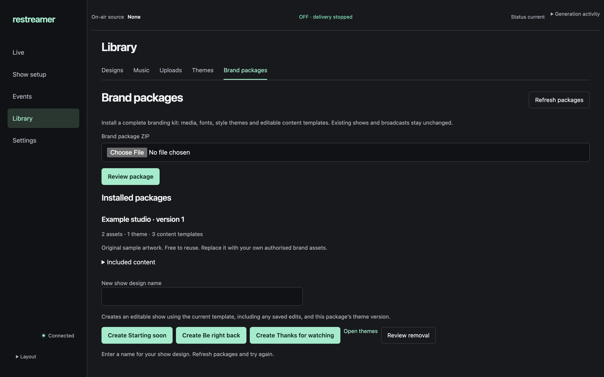

# Brand package validation

Implementation: #92, with the separately delivered private kit from #91. Review baseline: `55326a4`.

## Automated boundaries

`TestBrandPackage*` exercises authenticated HTTP import preview/publication, archive safety, compatibility, checksum/media/font validation, package upgrades, exact theme retention, restart recovery, removal and package-member ownership. Motion generation checks the rendered output and verifies that source audio remains silent. Packaged font and OBS border downloads use the existing asset/theme endpoints. `tests/brand-packages.test.mjs` exercises the actual browser module to verify current-template version selection and package-local action errors.

## Browser and rendered media

An isolated authenticated instance used documented dummy credentials, 1080p25 and no destinations. Native Chrome verification covered file selection, package review/import, creating an editable design, generation and removal preview. The removal preview correctly listed six unused sample-kit members; no browser deletion was performed. Backend deletion and reference protection were tested through HTTP.

Desktop at 1440×900 and phone emulation at 390×844 were inspected. Import/create/removal controls remain desktop-only; phones expose package inspection and theme access. A blank-name action demonstrated inline feedback beside the affected package. Phone verification was browser emulation, not a physical phone.

Actual private-kit Starting soon, BRB and Ending outputs were rendered at 1080p25 and reviewed at full and reduced preview size. The eight-second loop uses the complete source animation cycle. The matching OBS image has a transparent center. The user approved the treatment on 2026-11-11; no private source artwork or fonts are included here.

## Reviews

Standards: two findings, both resolved (desktop boundary and current template version). Specification: two findings, both resolved (current template version and package-member deletion). Impeccable finish review: ship after local feedback and phone-removal fixes; screenshot/source review did not include an independent keyboard or computed-style audit.

Exact-commit CI remains the delivery gate; the PR links the final run. Local test output is intermediate evidence, not release publication.
