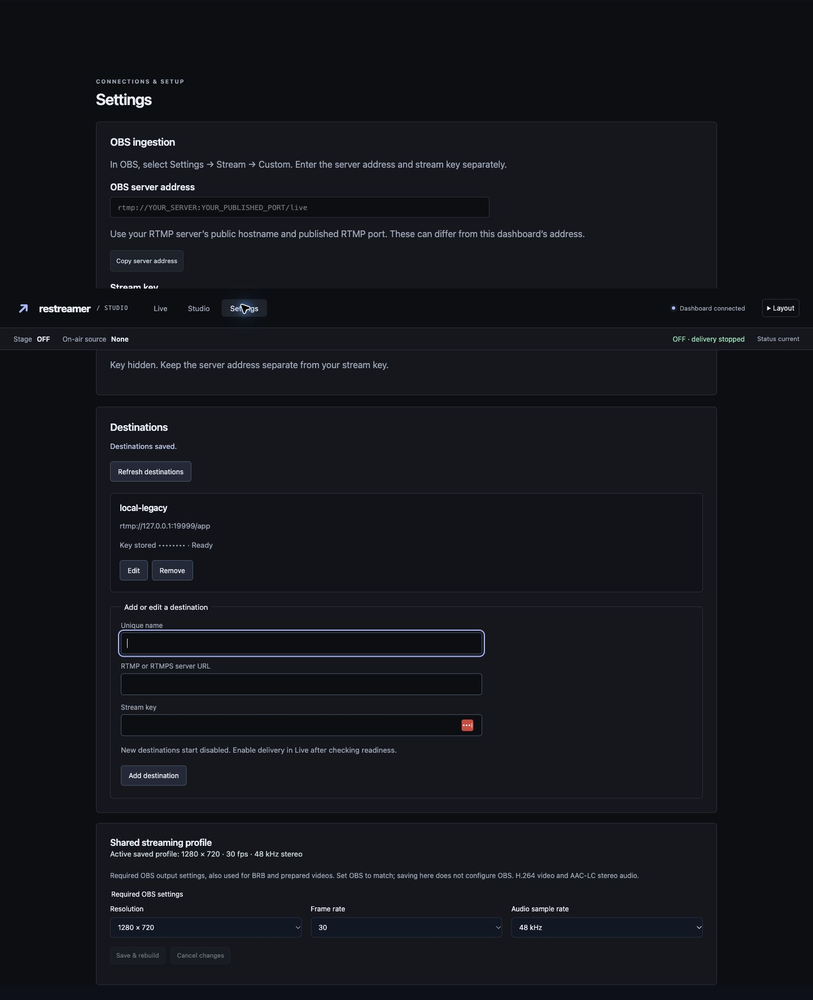
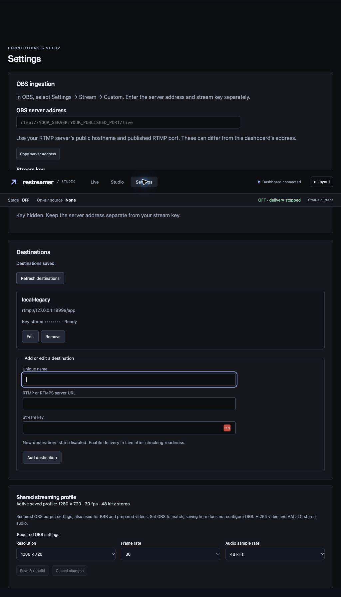
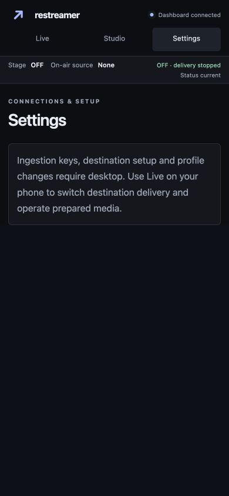
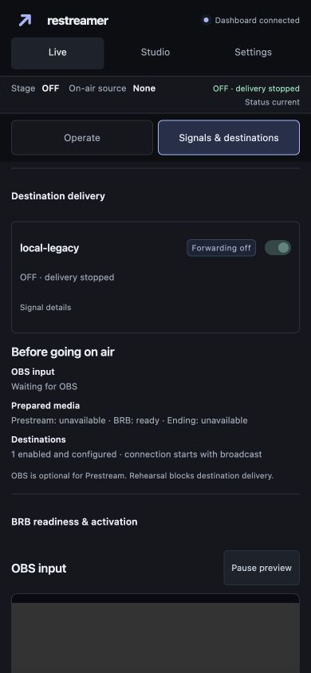

# Destination Settings verification (#50)

## Platform presets (2026-10-27)

New destinations offer Custom, Twitch, YouTube, and Kick. Twitch's secure default
comes from its [published ingest list](https://ingest.twitch.tv/ingests); YouTube's
primary RTMPS address matches the [OBS service definitions](https://github.com/obsproject/obs-studio/blob/master/plugins/rtmp-services/data/services.json).
Kick's [setup instructions](https://help.kick.com/en/articles/7066931-how-to-stream-on-kick-com)
require the server URL from the creator dashboard, so its preset supplies the name
and instructions without substituting an example endpoint.

Test-first form-boundary regressions cover prefills, editable names/URLs, explicit
save, key clearing on a platform change, Custom retaining entered values, failed
save retention, edit isolation, and reset after save/cancel. All 34 web tests and
the focused destination/Settings/workspace race tests passed, as did Go vet.
Each preset was also driven through the actual frontend handler and authenticated
localhost API with dummy keys; saved destinations remained disabled. No platform
was contacted. Chrome automation timed out, so desktop/mobile visual verification
could not be completed for this change. The separately reported unresponsive Save
button has not been reproduced and is not claimed fixed by these presets.

Verified 2026-10-12 using disposable authenticated localhost services, dummy
credentials and synthetic OBS input. No external platform was contacted.

## Browser behavior

- Empty setup rendered its guidance; adding a destination created a masked-key
  card and updated Live immediately, without restarting the service.
- Invalid HTTPS server URL returned a readable validation error and retained the
  draft. Live → Settings navigation retained the unsaved corrected URL. Saving
  with the key blank preserved the existing key and readiness.
- Native Chrome confirmation cancellation preserved a destination; accepting
  removal returned the empty-list state. Confirmation dialogs were operated via
  the native Chrome accessibility API to avoid the extension's pending-dialog
  click limitation.
- With a synthetic OBS feed in LIVE, an edit displayed its destination-only
  interruption warning and saved after confirmation. Removing the last enabled
  destination retained LIVE/OBS and displayed the no-delivery warning. Confirmed
  Stop now returned the fixture to OFF.
- An independent legacy-config fixture required explicit import before editing.
  Accepting import preserved the destination name, key presence, and disabled
  preference, then unlocked management.
- At 1440×900 and 1024×768, Settings included ingestion, destination management,
  and the real saved streaming profile with readable controls and no horizontal
  overflow. Detailed configuration scrolls within the Settings document.
- At 390×844, Settings showed the desktop-required explanation without management
  controls. Live → Signals & destinations still exposed and successfully changed
  the destination delivery preference while remaining OFF. Document width was 390.
- Save restored keyboard focus to Unique name. Credentials stayed masked and did
  not appear in shared status or layout preferences. Temporary viewport overrides
  were reset and all synthetic services were stopped after verification.

## Automated checks

Test-first authenticated Settings route/asset coverage failed before mounting the
module and passed afterward. Browser-boundary JavaScript regressions cover
omitting unchanged secrets, retaining drafts after failed writes or refresh,
guarding navigation, and preserving an unrelated credential draft when another
destination is removed (this last regression failed before its fix).

The focused race suite for Settings, destination CRUD/migration, workspace routes,
local RTMP, no-destination behavior, ENDING, and rehearsal passed (37.7 seconds).
All 21 web tests and `go vet ./...` passed before the final responsive-layout merge;
Settings/destination tests, all 24 web tests, and vet were checked again after merging.
Physical persistence failures, concurrent/stale writes, restart precedence,
authentication/origin rejection, and key replacement retain the existing #35
HTTP/local RTMP regression coverage. The orchestrator owns full final checks and
exact-SHA GitHub CI/image publication.

An optional additional native-browser full-document draft-navigation check was
not completed. Automatic approval review rejected a native tab-focus action
because it identified the target as an unrelated authenticated Confluence tab,
with private content outside this task. No workaround or unrelated interaction
was attempted. The known local browser handle was used only to cancel the dummy
draft. Navigation protection remains covered by the JavaScript regression and
actual Live/Settings draft retention described above.

## Evidence

