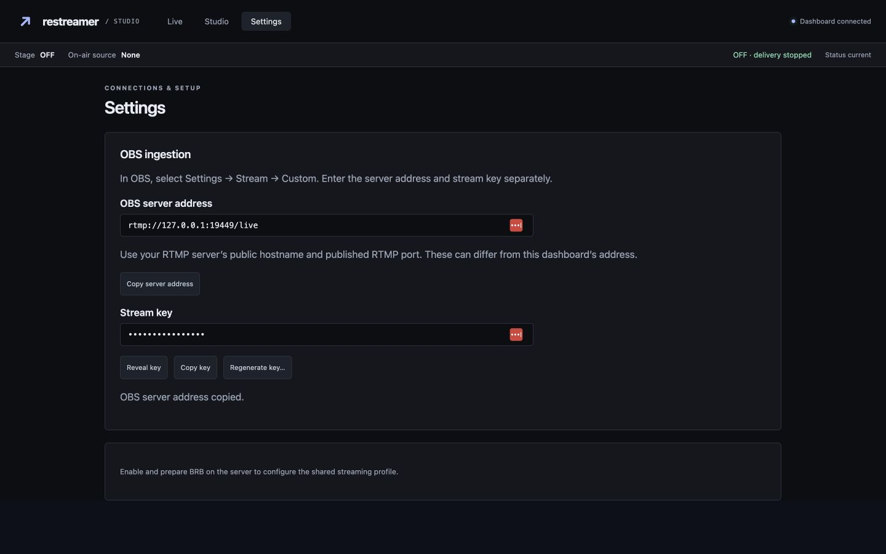
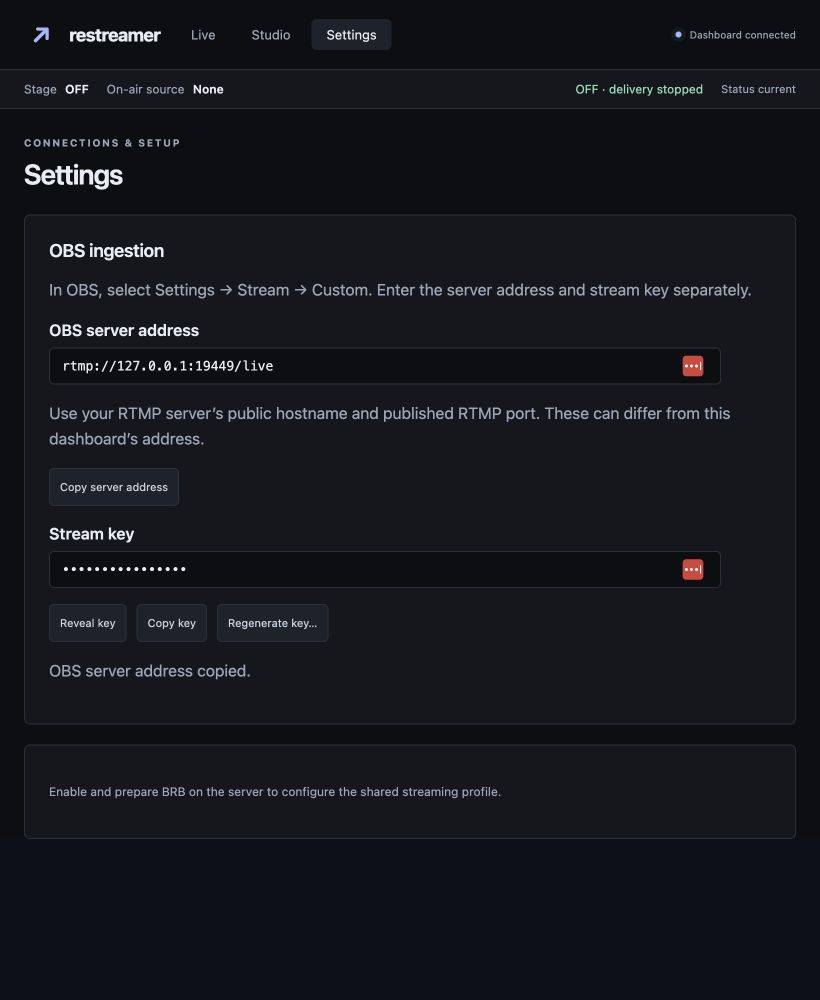
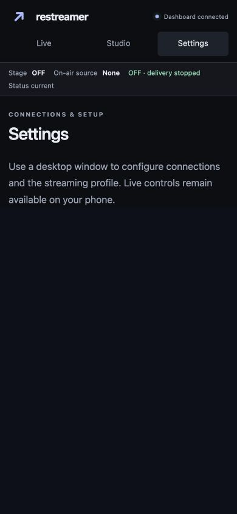

# Ingestion Settings verification (#49)

The Settings workspace hosts the real managed-ingestion controls. The old
standalone URL redirects to Settings, and Live no longer carries a separate
header link. The OBS address field requires an explicit RTMP hostname, published
port and application path; it does not infer a public RTMP endpoint from the
HTTP dashboard address.

Automated verification:

- Authenticated HTTP Settings placement and old-entrypoint redirect.
- Existing ingestion race/RTMP tests: persistent generated keys, legacy import,
  restart without broadcast resumption, confirmed revision-checked rotation,
  concurrent requests, write failure, authentication/origin checks, status
  redaction, connected-publisher retention, old-key rejection and new-key acceptance.
- Browser-boundary tests: metadata-only initial load, explicit key retrieval,
  masking on workspace exit (including delayed responses), clipboard success and
  failure, and server-address copying without retrieving a secret.

Commands: `node --test tests/ingestion.test.mjs`, targeted Go race tests covering
`TestIngestion`, `TestManagedIngestion`, and `TestWorkspaceNavigation`, and
`go vet ./internal/relay`.

Browser evidence uses a disposable local server, dummy dashboard credentials and
new temporary secret storage. Screenshots show masked keys only.

Browser verification on 2026-10-12:

- Desktop 1440×900: masked key, explicit reveal, copy-key success, explicit
  local RTMP address copying, and keyboard Tab from address to its Copy action.
- Leaving Settings for Live and returning cleared the revealed key and restored
  the masked state. No key appeared in committed screenshots.
- Narrow desktop/tablet 820×1000: controls remained readable and usable; document
  width equaled viewport width (820 pixels).
- Phone 390×844: setup controls were hidden and the desktop-required explanation
  remained readable alongside workspace navigation and broadcast status; document
  width equaled viewport width (390 pixels).
- The legacy standalone address redirected to `/settings#ingestion-settings`.
- Initial browser verification found that relative fetch URLs failed when Basic
  Auth credentials were embedded in the page URL. Management requests now use the
  credential-free origin, matching the application's other authenticated flows;
  a regression assertion and browser reload confirmed the fix.

Native regeneration confirmation was not reopened in this browser pass because
other concurrent ticket checks had demonstrated Chrome extension hangs while a
native confirm was open. Confirmation/revision enforcement, connected-publisher
retention, and successful/new versus rejected/old credentials were verified by
existing authenticated HTTP and local RTMP tests. Clipboard-denied and late
response/navigation races are covered by the browser-boundary tests.

