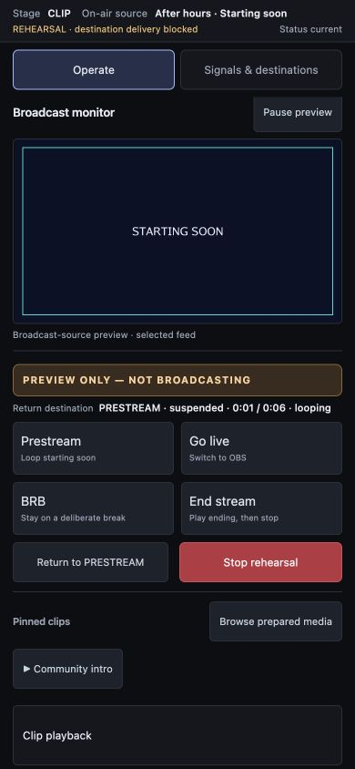
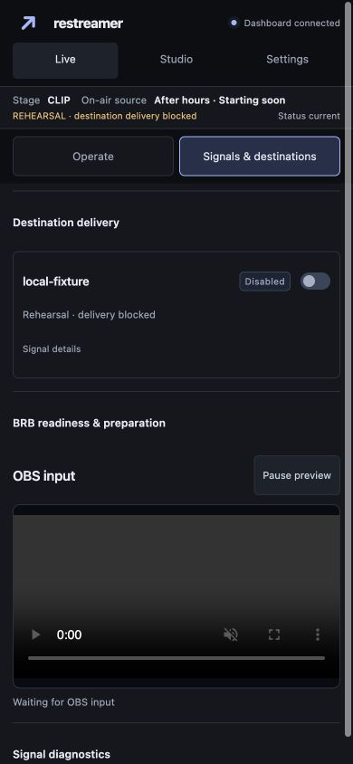
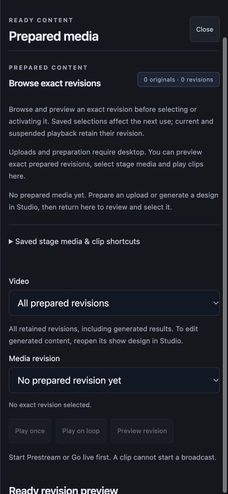
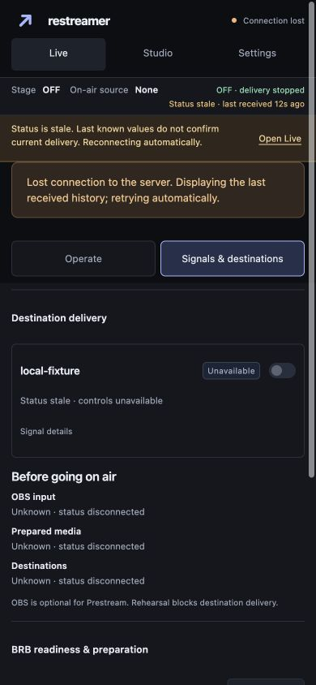

# Phone broadcast remote verification (#48)

An authenticated disposable localhost fixture used dummy credentials, two exact
prepared revisions and one disabled local destination. Playback ran exclusively
in preview-only rehearsal. No platform output or real credential was used.
Fixture processes were stopped after verification.

Test-first route coverage failed for the missing remote panels and desktop
capability explanations, then passed. Focused race coverage passed (41.279s),
covering workspace navigation, stage commands, rehearsal, clip replacement,
deliberate BRB and ending behavior. Eighteen Node tests, JavaScript syntax checks,
`go vet ./...` and whitespace checks passed. Final full checks and exact-SHA CI
belong to the parent delivery gate.

Browser verification:

- At 390×844 and 320×740, Operate and Signals show one focused panel at a time,
  with no horizontal overflow. Primary controls use at least 44px touch targets.
- Operate kept outgoing preview, stages and Stop/Return together. The actual
  prepared picture appeared in the broadcast monitor.
- Signals exposed destination health and switches. Changing saved delivery
  preference while OFF left the broadcast OFF; the preference was restored.
- Confirmed rehearsal Prestream → looping CLIP → deliberate BRB → Return resumed
  the retained clip and preserved its original PRESTREAM return destination.
- Pausing the browser preview left PRESTREAM unchanged. Exact revision review
  retained the selected stage. Existing confirmation dialogs remained usable.
- Prepared-media browsing explained the desktop upload boundary. An empty-library
  fixture displayed an explicit empty state and disabled preview/play actions.
  Escape closed the drawer and restored focus to its opener.
- Settings exposed the desktop-required explanation instead of credential or
  profile controls. Studio showed the authoring boundary and read-only browsing.
- Stopping the server produced a persistent stale-status warning and unavailable
  destination controls, with wrapped warnings remaining above the remote tabs.
- At 1024×768 and 1440×900, phone tabs disappeared and desktop panels remained
  available. The independently implemented desktop layout work is verified in #47.

