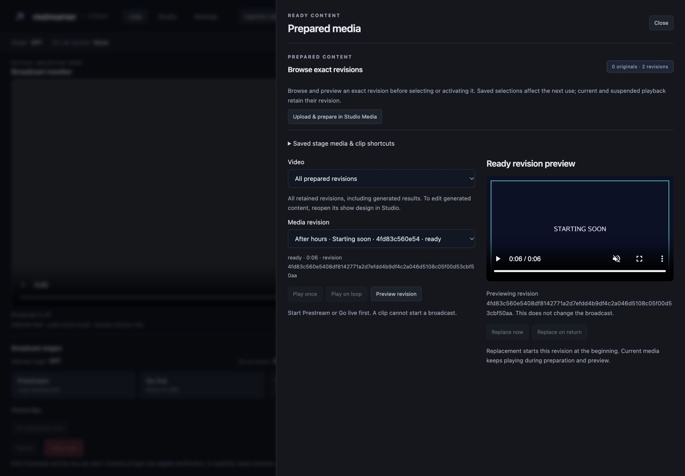
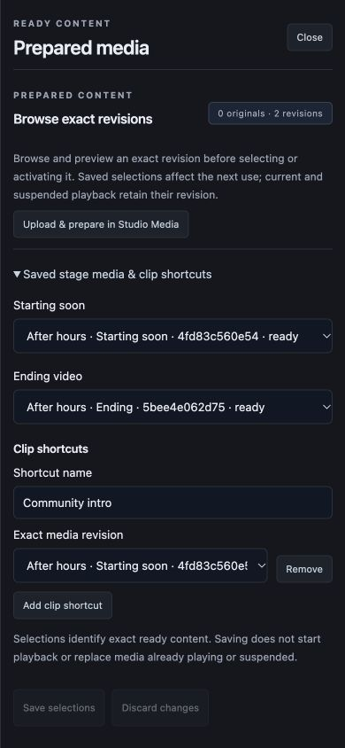
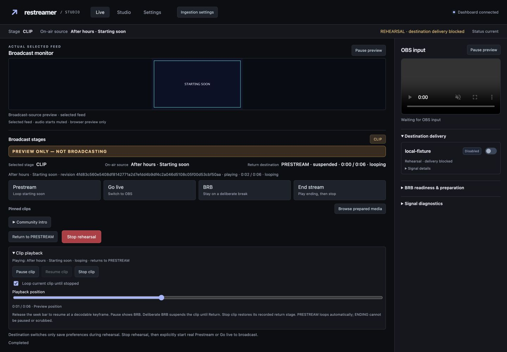

# Prepared media drawer verification (#41)

Used an isolated authenticated localhost fixture with dummy credentials, two ready
exact revisions and one saved clip shortcut. Its only destination was disabled.
All playback commands used preview-only rehearsal. The fixture was stopped after
verification.

The authenticated route regression failed before the drawer existed, then passed.
Focused race tests cover exact revision replacements, stale replacements, original
clip return stages, deliberate BRB suspension and protected ending behavior.
JavaScript tests and syntax checks passed; `go vet ./...` passed before integration.
The root delivery workflow runs the full race/vet and exact-SHA GitHub CI gates.

Browser checks:

- Desktop 1440×1000, narrow 800×900, phone 390×844: drawer readable; phone saved
  selections fit without horizontal overflow (390px document / 389px drawer).
- Opening and previewing exact media left the broadcast OFF. Clips stayed disabled
  until a stage was started explicitly.
- Changing a selection, closing and reopening retained the unsaved selection.
  Discard restored the saved value. Close returned keyboard focus to the opener.
- Explicit Prestream rehearsal, then Play on loop through the nested confirmation,
  produced CLIP with PRESTREAM as its recorded return stage.
- Pause showed BRB; resume and keyboard seek worked. Stop clip restored PRESTREAM
  and hid detailed clip controls. Stop rehearsal returned OFF.
- The outgoing monitor displayed actual prepared content. Studio Media link opened
  the real Media collection. Browser console had no errors.

Loading, empty, unavailable and preparation-error messages remain explicit; the
seeded browser fixture exercised the ready state. No deletion or real destination
broadcast was performed.

