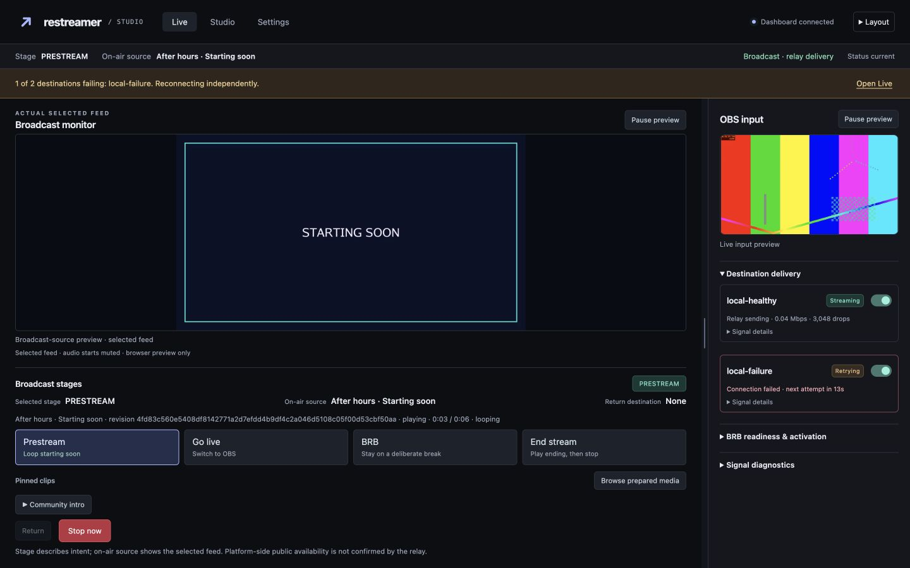
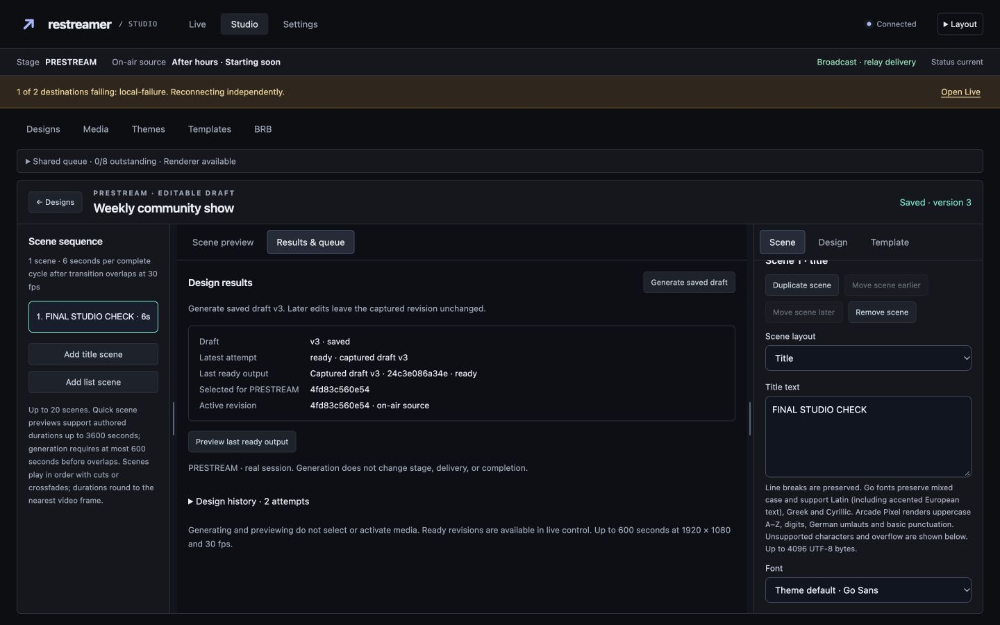
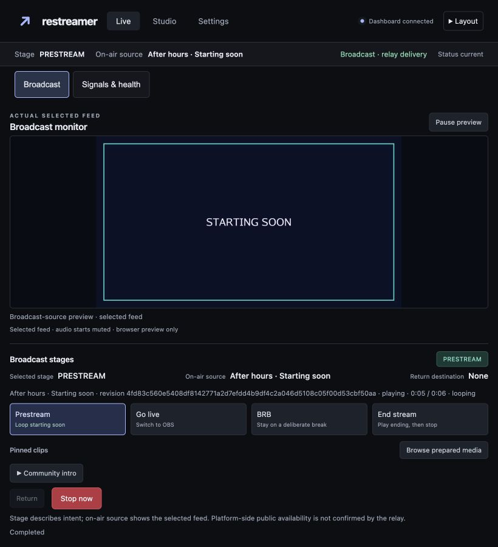
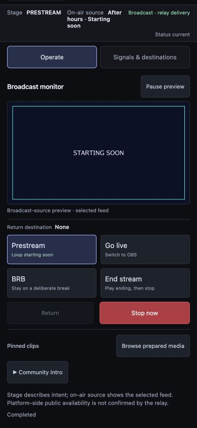

# Production studio: assembled acceptance (#51)

Verified on 2026-10-12 in authenticated Chrome with disposable `stage-test` fixtures. The fixture had three saved designs, ready prestream/ending revisions, a pinned clip, synthetic OBS input, one local RTMP receiver, and one intentionally unreachable local destination. No platform destination or real credential was used.

## Composed journeys

- Started real PRESTREAM through its exact-revision review. The outgoing monitor played the saved starting-soon video while the smaller OBS monitor played synthetic test input. Both HTML videos reported `readyState=4`, 1280×720, advancing playback and `paused=false`.
- One local destination streamed while the other retried. The named partial-failure alert remained visible in Studio and Settings. In Studio, edited a different design, observed autosave v3, started generation, and navigated through Themes, Settings and Live. Generation completed in the background; PRESTREAM retained its original exact revision. Active Settings correctly locked profile changes.
- Disabled only the failing destination. Its alert cleared and the healthy destination continued streaming. Resized the same broadcast to 820×900 and 390×844. The phone document width equaled its 390px viewport; actual output continued playing and the prepared-media drawer remained usable.
- On the phone, previewed the newly generated exact revision. Its identity differed from the active prestream revision; preview did not replace the active source. Closed the drawer and returned to the same running broadcast.
- Stopped the disposable broadcast through the stage review. Imported its legacy localhost destinations through the real native confirmation. A destination draft survived Live → Settings, with the ingestion key still a password input.
- Found and fixed a browser navigation defect: relying only on `beforeunload` allowed a dirty Settings draft to disappear when opening Studio. Workspace departures now explicitly consult the existing dirty-form guards and request one discard confirmation. This includes profile, destination, design/theme, prepared selection and BRB drafts. After rebuilding, Cancel retained the destination name and unsaved 25fps profile; Accept opened Studio without a second prompt. Same-document Live/Settings and modified new-tab clicks do not discard the current document.
- Deleted the disposable generated design through its native confirmation. The UI reported one generated file deleted, uploads retained, and shared output retained for another result. The newly generated revision file was absent afterward; the other two designs and their shared ready output remained.

## Cleanup and boundary regression

Removed the superseded standalone ingestion form and unused styles; its authenticated compatibility redirect to Settings remains. Updated operator wording and the managed ingestion configuration reference, retaining the destination migration instructions.

A red startup regression demonstrated that overlapping ingestion/state paths could write a credential into the switch-state location, and relative destination-path aliases bypassed the old comparison. Initialization now resolves and checks all three storage paths before any store creates a file. The authenticated boundary test covers each pair with absolute and relative aliases and verifies that rejected startup writes no files.

## Validation

- Focused credential/destination race suite: passed (2.309s).
- Focused workspace, phone, prepared-media, credential-path and physical deletion regressions: passed (3.465s; localhost-listener tests rerun with the required sandbox permission).
- Node browser-boundary suites and BRB animation checks: 30 passed.
- `go vet ./...`: passed.
- Full race/vet gate ran successfully on the assembled integration before these final fixes; final SHA CI and main image publication remain the release coordinator's delivery gate.

The browser extension did not reliably track native JavaScript dialogs after native dismissal. Dialog outcomes were checked against the fresh native accessibility tree on the exact task-owned local tab. No browser permissions were changed. The native PNG/MP4 upload-picker gap was subsequently resolved by the release coordinator; see [review resolutions](production-studio-review.md). Detailed theme/rehearsal/layout journeys are recorded in the earlier slice evidence; this pass did not repeat those checks.

All synthetic publishers, local receivers and fixture servers were stopped after verification. Temporary viewport overrides were reset.

## Screenshots

